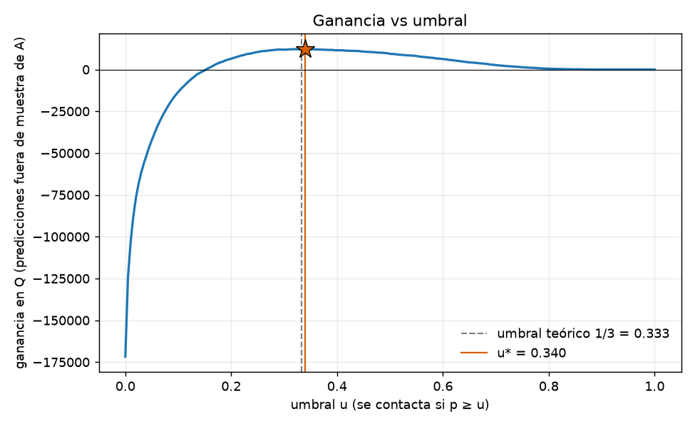
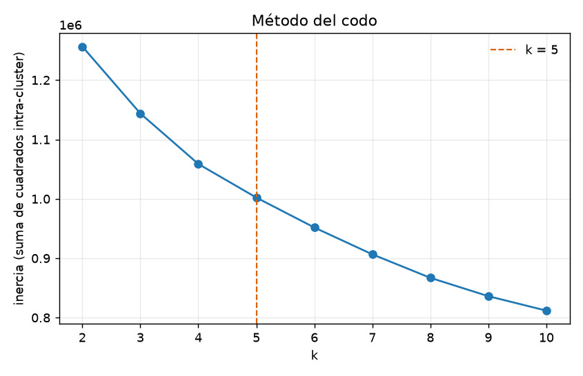
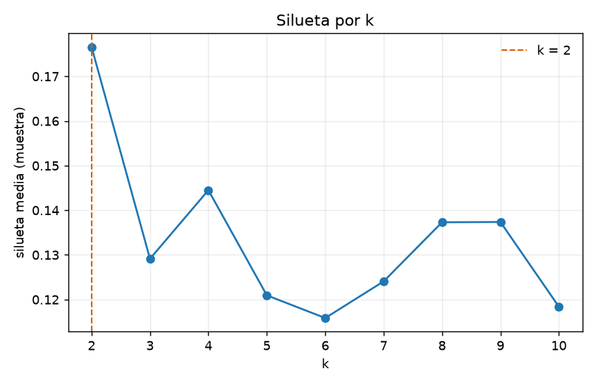
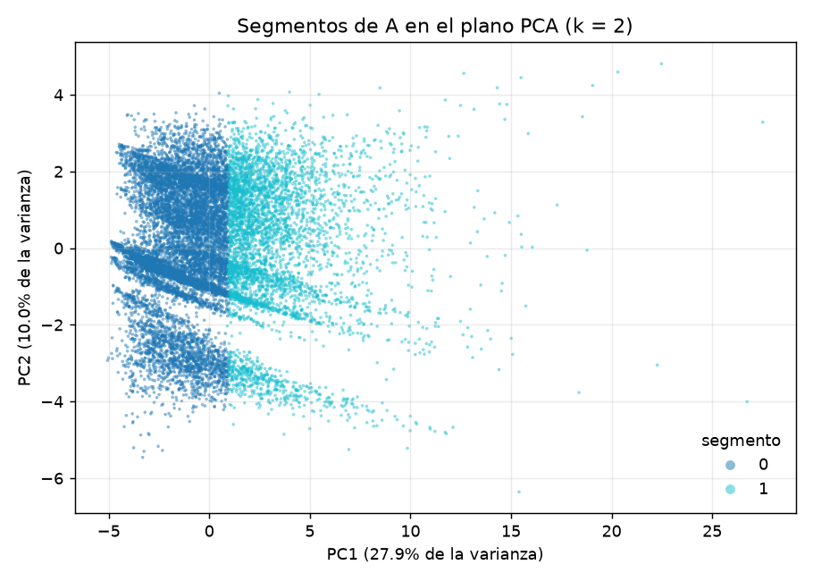

# Informe de la Fase 2 · Proyecto 2: ¿Quién deja de usar la red?

Agencia Metropolitana de Transporte · URL, Ciencia de Datos, segundo semestre 2026. Datos simulados (v2 de la cátedra,
2026-06-01 a 2026-08-29). Secciones 2.1 a 2.4 del enunciado; la fase 1 está en `docs/P2/INFORME_FASE1.md`. Decisiones:
ADR-016 y ADR-017; bitácora: `docs/P2/BITACORA.md`; ficha del modelo: `docs/P2/FICHA_MODELO.md`; checklist:
`docs/RUBRICA_CHECKLIST_P2.md`.

Recordatorio del problema: por **persona** (`unidad_id = usuario_unificado_sk`) y fecha de corte t, etiqueta 1 si no hay
ningún abordaje válido en [t, t+30). Corte A = 2026-07-01 (51 955 personas, 5 869 positivos, tasa 0,1130) para entrenar con
validación cruzada estratificada de 5 pliegues; B = 2026-07-31 (50 483, tasa 0,1022) para un único test; C = 2026-08-30
(49 853, etiqueta oculta) para las predicciones entregadas. Métrica principal: Average Precision (AP), cuyo valor para un
modelo sin información es la tasa positiva.

## 2.1 Ensemble, sesgo y varianza

**Comando:** `make ml-entrenar FASE=2` (`python -m ml.entrenar --fase 2 --con-rf`), 229 s. Los ensambles usan **los mismos
pliegues** de la fase 1 (`ml/artefactos/folds_A.csv`, semilla 2026), así que las filas de la tabla son comparables.

| Modelo | AP entrenamiento | AP validación (media ± sd) | ROC-AUC | Brier |
|---|---:|---:|---:|---:|
| Línea base constante (tasa de A) | 0,1130 | 0,1130 ± 0,0000 | 0,5000 | 0,1002 |
| Línea base de una feature (`dias_desde_ultimo`) | 0,4096 | 0,4101 ± 0,0186 | 0,8417 | n. a. (no es probabilidad) |
| Logística L2 / L1 / ElasticNet (λ*) | 0,4506 | 0,4459 ± 0,0160 | 0,8501 | 0,0782 |
| **HistGradientBoosting** (lr 0,05 · 400 iteraciones · 15 hojas) | 0,6096 | **0,4680 ± 0,0205** | 0,8613 | 0,0768 |
| RandomForest (400 árboles, hoja mínima 5) | 0,8092 | 0,4527 ± 0,0227 | 0,8587 | 0,0775 |

Fuente: `docs/evidence/p2/fase2_modelos.md` (incluye las 16 combinaciones de la grilla de HistGradientBoosting).

**Sesgo y varianza** (`docs/evidence/p2/fase2_sesgo_varianza.md`; brecha = AP de entrenamiento − AP de validación):

| Modelo | Brecha | Lectura |
|---|---:|---|
| Una feature | −0,0005 | Sin varianza; todo su error es sesgo (una sola variable, sin interacción). |
| Logística | 0,0048 | No sobreajusta. Con 33 features y 52 mil filas su límite es el sesgo de la forma lineal: por eso λ casi no movía la métrica en la fase 1. |
| HistGradientBoosting | 0,1415 | Reduce sesgo (capta no linealidades e interacciones) a cambio de varianza. La grilla lo muestra: con 31 hojas y lr 0,1 el AP de entrenamiento sube a 0,88 y el de validación baja a 0,45; se eligió la configuración de árboles pequeños. |
| RandomForest | 0,3565 | El de más varianza: memoriza el entrenamiento (0,81) y valida peor que el boosting. |

**Importancia por permutación** (HistGradientBoosting; caída media de AP al permutar la feature **en el pliegue de
validación**, 10 repeticiones por pliegue; `docs/evidence/p2/fase2_importancias.md`):

| # | Feature | Caída de AP | sd entre pliegues |
|---:|---|---:|---:|
| 1 | `dias_desde_ultimo` | 0,2398 | 0,0172 |
| 2 | `zona_principal` | 0,0154 | 0,0031 |
| 3 | `dias_activos_7d` | 0,0145 | 0,0076 |
| 4 | `n_abordajes_7d` | 0,0139 | 0,0080 |
| 5 | `ratio_ult14_prev14` | 0,0135 | 0,0046 |
| 6 | `perfil_padron_a_t` | 0,0096 | 0,0020 |
| 7 | `gasto_q_28d` | 0,0094 | 0,0028 |
| 8 | `hora_sd` | 0,0072 | 0,0033 |
| 9 | `n_abordajes_28d` | 0,0070 | 0,0043 |
| 10 | `n_zonas_28d` | 0,0065 | 0,0064 |

La recencia domina: sin `dias_desde_ultimo` el modelo pierde la mitad de su AP, y la segunda feature pesa 16 veces menos.
Las siguientes son variantes de actividad reciente y tendencia (última semana, razón de los últimos 14 días contra los 14
anteriores), la zona habitual y el perfil del padrón **a la fecha de corte**. Las features de actividad están
correlacionadas entre sí, de modo que la permutación reparte su importancia y cada una por separado parece pequeña.

**Decisión** (`docs/evidence/p2/fase2_decision.md`): se entrega **HistGradientBoosting v1.0.0**.

- La mejora media sobre la logística (0,022 de AP) es del tamaño de una desviación entre pliegues, pero es consistente:
  con los mismos pliegues gana en los cinco (0,016 · 0,037 · 0,026 · 0,019 · 0,013).
- En la decisión económica también gana: con las predicciones fuera de muestra de A da Q12 200 contra Q11 465 de la
  logística con su mejor umbral (6 % más).
- Está bien calibrado sin ajuste adicional (Brier 0,0768; ver 2.2).
- Costo aceptado: se pierde la lectura directa de coeficientes (se suple con la permutación) y hay más varianza. La
  ganancia sobre la línea base de una feature es real pero moderada (+0,058 de AP): la mayor parte de la señal ya está en
  "cuántos días lleva sin viajar".
- Descartados: logística (menor AP y menor ganancia en todos los pliegues), RandomForest (más varianza y menor AP) y
  reentrenar con A ∪ B antes de predecir C (el test de B dejaría de describir el modelo entregado).

## 2.2 Umbral por costo y test único

**Escenario.** Contactar a una persona cuesta Q5. Si iba a abandonar (y = 1), la campaña la retiene con probabilidad 25 %
y retenerla vale Q60. Si no iba a abandonar, el contacto solo cuesta.

**Fórmula.** Ganancia esperada de contactar a una persona: 0,25 × 60 × y − 5 = 15·y − 5. Para un umbral u se contacta a
quien tiene puntaje ≥ u:

> G(u) = 15·TP(u) − 5·(TP(u) + FP(u))

Con probabilidades calibradas conviene contactar si 15·p > 5, es decir **p > 1/3** (umbral teórico).

**Umbral elegido.** u* = argmax G(u) sobre las predicciones **fuera de muestra de A** (cada persona puntuada por el modelo
que no la vio), malla de 201 umbrales: **u* = 0,340** (`docs/evidence/p2/umbral.md`).

- Contactados: 5 102 de 51 955 (TP = 2 514, FP = 2 588); precisión 0,4927, recall 0,4284.
- G = 15 × 2 514 − 5 × 5 102 = 37 710 − 25 510 = **Q12 200** (Q234,82 por cada 1 000 personas).
- Referencias: no contactar a nadie = Q0; contactar a todos = 15 × 5 869 − 5 × 51 955 = **−Q171 740**.



El umbral empírico queda a 0,007 del teórico, lo que indica que las probabilidades están calibradas; la tabla por deciles
lo confirma (decil 10: probabilidad media 0,499 y tasa observada 0,489; decil 9: 0,256 y 0,251;
`docs/evidence/p2/calibracion.md`). No se recalibró.

**Evaluación única en el corte B** (`make ml-test-b`; `docs/evidence/p2/test_b.md`; entrada en `docs/P2/BITACORA.md`):

| Dato | Valor |
|---|---|
| Fecha | 2026-11-12T04:36:54Z (2026-11-11 22:36 hora local) |
| Commit | `29e8b14ac5202d7dd81a4fd4f812583a28e2fce0` |
| Modelo | `churn_persona_v1.0.0.joblib`, sha256 `350b8fca…68770b` |
| Umbral | 0,340 (fijado con A antes de ver B) |
| AP | **0,4214** (línea base constante en B = tasa positiva = 0,1022) |
| ROC-AUC · Brier | 0,8591 · 0,0731 |
| Precisión · recall | 0,4357 · 0,4497 |

| | Predicho 0 | Predicho 1 |
|---|---:|---:|
| Real 0 | 42 319 | 3 005 |
| Real 1 | 2 839 | 2 320 |

**Ganancia en B:** 15 × 2 320 − 5 × (2 320 + 3 005) = 34 800 − 26 625 = **Q8 175** (Q161,94 por cada 1 000 personas).

Lectura franca del resultado:

- El AP en B (0,421) es menor que el de validación cruzada (0,468 ± 0,021): unas dos desviaciones por debajo. Parte se
  explica porque B tiene menos positivos (10,2 % contra 11,3 %) y el AP depende de la tasa base; el ROC-AUC, que no
  depende de ella, casi no cambia (0,861 → 0,859). El resto es el optimismo esperable de un ensamble con brecha
  entrenamiento-validación de 0,14 al pasar a otro mes.
- La ganancia por 1 000 personas baja de Q235 a Q162 (−31 %): la precisión entre los contactados cae de 0,493 a 0,436. Aun
  así es positiva, muy por encima de no hacer nada (Q0) y de contactar a todos (15 × 5 159 − 5 × 50 483 = −Q175 030).
- El número que se reporta como desempeño esperado es el de B, no el de validación.
- **Cómo se garantiza que fue una sola vez:** `ml/evaluar_b.py` exige árbol de git limpio, aborta si ya existe
  `ml/artefactos/evaluacion_b.json` o el marcador en la bitácora, y escribe el registro antes de calcular. Ningún
  parámetro, umbral ni feature se modificó después de ver B. La línea base de una feature y la logística **no** se
  evaluaron en B: hacerlo habría sido un segundo uso de la etiqueta.

## 2.3 Segmentos de comportamiento (KMeans y PCA)

**Comando:** `make ml-segmentos`. KMeans (n_init = 10, semilla 2026) sobre las features numéricas de comportamiento del
corte A, imputadas con la mediana y estandarizadas; la etiqueta no entra al agrupamiento.

**Elección de k** (`docs/evidence/p2/segmentos_k.md`):

| k | 2 | 3 | 4 | 5 | 6 | 7 | 8 | 9 | 10 |
|---|---:|---:|---:|---:|---:|---:|---:|---:|---:|
| Silueta | **0,1766** | 0,1291 | 0,1445 | 0,1209 | 0,1159 | 0,1241 | 0,1373 | 0,1374 | 0,1184 |

 

La inercia baja de forma suave, sin un quiebre nítido (el criterio geométrico del codo señala k = 5); la silueta es máxima
en **k = 2** y con k = 5 cae a 0,121. Se eligió k = 2. Una silueta de 0,18 es baja: los datos no forman grupos separados,
sino un continuo de intensidad de uso que KMeans corta en dos. Los segmentos sirven para describir y para diferenciar la
acción, no como tipos naturales de usuario.

**PCA.** Las dos primeras componentes explican el 37,9 % de la varianza (27,9 % + 10,0 %); la primera ordena a las
personas por intensidad de uso y es la que separa los segmentos.



**Segmentos** (medianas en unidades originales; `docs/evidence/p2/segmentos.md`):

| Segmento | Personas | % | Tasa de abandono | Abordajes 28 d | Días activos 28 d | Días activos 7 d | Zonas | Estaciones | Gasto 28 d |
|---|---:|---:|---:|---:|---:|---:|---:|---:|---:|
| 0 · Ocasionales de baja frecuencia | 36 454 | 70,2 % | **0,152** | 8 | 6 | 1 | 3 | 3 | Q11,0 |
| 1 · Habituales intensivos | 15 501 | 29,8 % | **0,021** | 32 | 16 | 5 | 7 | 10 | Q51,9 |

Tasa global de A: 0,113. La tasa por segmento es descriptiva: no prueba que pertenecer al segmento cause el abandono.

**Acciones** (`docs/evidence/p2/acciones.md`):

1. **Ocasionales de baja frecuencia: recarga de cortesía condicionada al uso.** Recarga de Q5 que se activa al hacer dos
   viajes en los 7 días siguientes, enviada el día del corte con recordatorio a los 5 días sin viaje. Aquí está el riesgo
   (7 veces la tasa del otro segmento), así que aquí se concentra el presupuesto, priorizando por el puntaje del modelo y
   el umbral de 2.2. Indicador: proporción de contactados con al menos un abordaje en los 30 días siguientes frente a un
   grupo de control.
2. **Habituales intensivos: alerta temprana sin costo por contacto.** Con abandono de 2,1 % la ganancia esperada de
   contactarlos a todos es negativa (15 × 0,021 − 5 < 0). En su lugar, si una persona de este segmento pasa 7 días sin
   viajar se le envía un aviso de servicio (cambios de ruta, estado de su tarjeta) y se revisa si hubo una incidencia en su
   estación habitual. Indicador: días de silencio hasta el retorno y tasa de abandono del segmento mes a mes.

## 2.4 MLOps: predicción, versión, entorno e invariancia

**Comando de predicción** (enunciado):

```bash
python predecir.py --datos docs/P2_datos_red/datos_red --fecha-corte 2026-08-30
```

`predecir.py` (1) verifica el sha256 de los nueve archivos de `--datos` contra lo ingerido; (2) lee las features del corte
desde `features.churn_dataset` y las tarjetas desde `silver.silver_unidad_tarjetas_corte` (o desde el respaldo
`predicciones/features_corte_2026-08-30.csv` con `--origen csv`, sin GCP); (3) carga el modelo guardado **sin reentrenar** y
exige la misma versión de scikit-learn y toma las columnas en el orden guardado con el modelo; (4) escribe `unidad_id,tarjetas,puntaje,contactar`.

**Entregable:** `predicciones/predicciones_corte_2026-08-30.csv`: 49 853 filas (una por persona de la población de C, sin
duplicados ni tarjetas vacías), **6 052 a contactar** (12,1 %) con umbral 0,340; 17 s. `tarjetas` lista, separadas por `;`,
las llaves nativas de la persona observadas antes del corte; `puntaje` va redondeado a 6 decimales. Si las probabilidades
se mantienen calibradas, la ganancia esperada de la campaña es Σ(15·p − 5) sobre los contactados ≈ Q16 000 con un costo de
Q30 260; ajustada por la caída observada entre validación y B, una expectativa prudente es del orden de Q160 por cada
1 000 personas (≈ Q8 000).

**Modelo versionado:** `ml/modelos/churn_persona_v1.0.0.joblib` más `churn_persona_v1.0.0.json` (versión, commit de
entrenamiento, 33 features en orden, umbral, semilla, versiones de librerías, métricas de validación y sha256 del
archivo); `ml/modelos/ACTUAL` apunta al vigente.

**Entorno reproducible:** `requirements.txt` con versiones fijas (scikit-learn 1.9.1, numpy 2.5.3, pandas 3.0.5), las
mismas en `vm/Dockerfile.airflow`; semilla 2026 en `ml/config.py`; pliegues guardados en `ml/artefactos/folds_A.csv`.

**Ficha del modelo:** `docs/P2/FICHA_MODELO.md`.

**Prueba de invariancia** (más datos posteriores al corte no deben cambiar las predicciones):

| Prueba | Qué compara | Resultado |
|---|---|---|
| Ensayo con el corte B (`make ensayo-invariancia`) | Predicciones de B con todos los datos contra predicciones de B con el warehouse reconstruido solo con datos hasta el 30 de julio (30 días menos) | 50 483 filas, **0 diferencias** en `tarjetas`, `contactar` y `puntaje` (`docs/evidence/p2/invariancia_B.md`) |
| Origen BigQuery contra origen CSV (corte C) | El mismo corte leído del warehouse y del respaldo CSV | 49 853 filas, 0 diferencias |
| Tarea `ml.ml_invariancia` del DAG | El CSV que genera la VM en cada corrida contra el CSV oficial versionado | ver `docs/P2/BITACORA.md` (corrida de la fase 2) |

El ensayo con B no usa la etiqueta de B: solo compara predicciones. Por qué se cumple: toda feature mira registros con
fecha < t y ventanas ≤ 28 días (prueba de recorte, fase 1); las tarjetas de cada persona son las observadas antes de t; la
regla R03 envía a cuarentena los registros posteriores a `fecha_referencia`; los seudónimos dependen de una sal HMAC que
no se rota; y el modelo se carga, no se reentrena. El guion para repetirla en vivo con el zip de la cátedra está en
`docs/GUIA_DEFENSA.md` §P2.2.

## Límites

- Los datos son simulados; las cifras describen el simulador, no a usuarios reales.
- El 25 % de retención y los Q60 son supuestos del enunciado. La ganancia es lineal en ambos: con otra tasa de retención r
  el umbral teórico pasa a 5 / (60·r).
- El modelo predice quién abandonará, no quién responderá al contacto. Medir el efecto de la campaña exige un grupo de
  control (modelo de respuesta incremental).
- Un solo corte de entrenamiento y uno de prueba, ambos en el mismo trimestre: no se midió estacionalidad.
- Mejora documentada y no aplicada: reentrenar con A ∪ B antes de predecir C (más datos y más recientes) como versión
  1.1.0, con su propio CSV.
