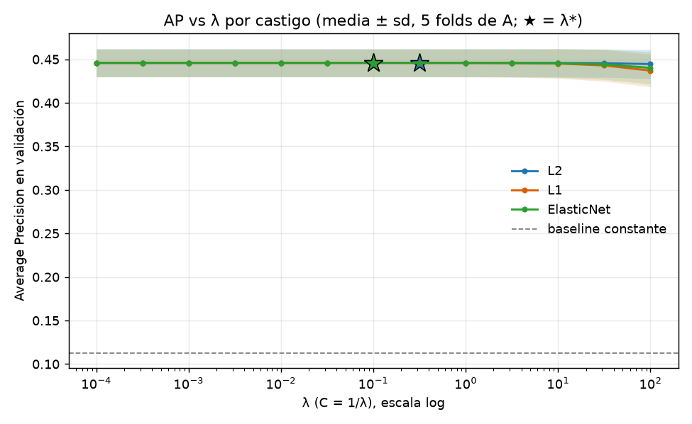
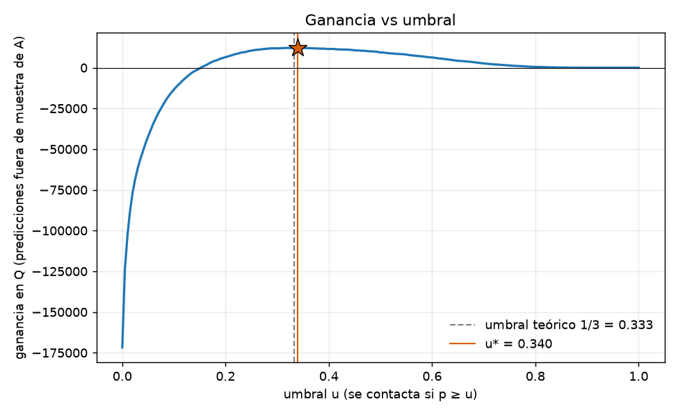
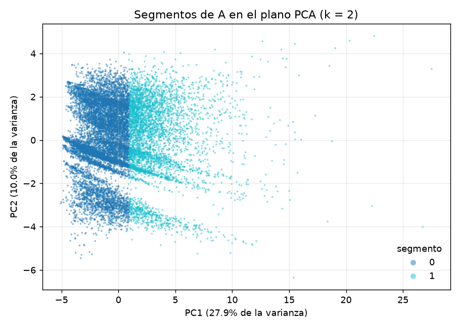

# Presentación · Proyecto 2: ¿Quién deja de usar la red?

15 minutos, 12 láminas (unos 75 segundos por lámina). Todas las cifras salen de `docs/evidence/p2/`, de
`docs/P2/INFORME_FASE1.md` y de `docs/P2/INFORME_FASE2.md`. Los datos son simulados.

## Lámina 1 · Problema y cortes A, B y C
- Pregunta: ¿qué persona no tendrá ningún abordaje válido en los 30 días siguientes a la fecha de corte t?
- Etiqueta 1 si no hay abordaje en [t, t+30); clasificación binaria por persona (`usuario_unificado_sk`).
- Corte A = 2026-07-01 entrena (validación cruzada de 5 pliegues); B = 2026-07-31 es el test, una sola vez; C = 2026-08-30 es la entrega.
- Población: al menos 2 abordajes en 28 días y ningún DELETE del CDC antes de t: A 51 955, B 50 483, C 49 853 personas.

Figura/archivo: `../evidence/p2/conteos_capas.md`

Notas del orador: Dejar claro desde el inicio que A entrena, B se abre una vez y C es lo que se entrega. Las tres poblaciones son comparables porque se construyen con la misma regla.

## Lámina 2 · Carga desde cero
- Un comando (`make desde-cero`) vacía, carga los nueve archivos v2 y deja la evidencia.
- Bronze coincide con el LEEME: 3 405 575 filas esperadas, 3 405 575 cargadas, diferencia 0 en los nueve archivos.
- Suma de tareas del DAG: 877,3 s; Kafka consumidor (107,5 s) y dbt silver (122,1 s) son las etapas más largas.
- La sal HMAC y el landing se conservan, de modo que los seudónimos no cambian.

Figura/archivo: `../evidence/p2/conteos_bronze.md`, `../evidence/p2/tiempos.md`

Notas del orador: Los conteos son la prueba de que no se perdió ni se duplicó nada al reconstruir. El borrado es destructivo y solo corre con la frase de confirmación.

## Lámina 3 · La unidad es la persona
- Una persona puede tener varias tarjetas; la unidad es `usuario_unificado_sk` (ADR-014).
- De 89 037 tarjetas activas en la ventana de A, 15 808 no abordan en el horizonte.
- De esas 15 808, 7 038 (0,445) pertenecen a personas que siguieron viajando con otra tarjeta.
- Con la unidad tarjeta, casi la mitad de los supuestos abandonos serían falsos.

Figura/archivo: `../P2/INFORME_FASE1.md` (sección 1.2); `../../analysis/p2_costo_unidad.sql`

Notas del orador: El costo de elegir mal la unidad se midió, no se supuso. Contactar a quien sigue viajando es gasto sin efecto.

## Lámina 4 · Features a la fecha de corte y prueba de recorte
- Ventanas de 7, 14 y 28 días, iguales en los tres cortes, solo desde Silver.
- Prueba de recorte: features de A con datos completos contra datos cortados antes de t: 51 955 filas, 0 diferencias.
- El borrador ingenuo sí fallaba: 49 058 filas distintas y cuatro fugas reales (`perfil_padron_final` 14 467, `estado_padron_final` 15 381, `es_vigente_padron` 13 990, `n_registros_operacion` 46 715 filas distintas).
- Dos diferencias menores no eran fuga sino orden de suma en coma flotante (4 y 2 filas); se corrigieron con sumas enteras.

Figura/archivo: `../evidence/p2/prueba_recorte.md`, `../evidence/p2/prueba_recorte_ingenuo.md`, `../evidence/p2/prueba_recorte_fallos.json`

Notas del orador: Las fuentes de fuga eran estados finales del padrón y conteos de todo el periodo. La prueba las detectó y por eso las cifras posteriores son confiables.

## Lámina 5 · Líneas base y regresión logística
- Constante (tasa de A): AP 0,1130.
- Una sola feature, `dias_desde_ultimo`: AP de validación 0,4101.
- Logística L2, L1 y ElasticNet con el mismo λ elegido: AP 0,4459 ± 0,0160, ROC-AUC 0,8501, Brier 0,0782.
- Brecha entre entrenamiento y validación de 0,005: equilibrada, el límite es la forma lineal.

Figura/archivo: 

Notas del orador: Una sola variable ya rinde 0,41, así que cualquier modelo más complejo debe justificarse frente a esa línea base. Los folds son los mismos en todos los modelos.

## Lámina 6 · Ensemble y sesgo-varianza
- HistGradientBoosting (tasa 0,05, 400 iteraciones, 15 hojas): AP de validación 0,4680 ± 0,0205; gana a la logística en los 5 folds.
- RandomForest: AP 0,4527 con train 0,8092; se descarta por varianza.
- Brecha train - validación: logística 0,005, HistGradientBoosting 0,14, RandomForest 0,36.
- Con 31 hojas el AP de entrenamiento sube a 0,88 y el de validación baja a 0,45.

Figura/archivo: `../evidence/p2/fase2_modelos.md`, `../evidence/p2/fase2_sesgo_varianza.md`

Notas del orador: El ensemble reduce el sesgo a cambio de varianza; elegimos árboles pequeños para controlarla. La mejora de 0,022 es del tamaño de una desviación entre folds, pero consistente.

## Lámina 7 · Importancia por permutación
- `dias_desde_ultimo` concentra la señal: caída de AP de 0,240.
- Le siguen `zona_principal` (0,015), `dias_activos_7d` (0,015) y `n_abordajes_7d` (0,014).
- Es coherente con que la línea base de una sola feature ya llegue a 0,410.
- Se pierde la lectura directa de coeficientes y se compensa con esta medición en validación.

Figura/archivo: `../evidence/p2/fase2_importancias.md`

Notas del orador: La recencia domina; el resto aporta ajustes pequeños. La ganancia del modelo sobre la línea base es real pero moderada (+0,058 de AP).

## Lámina 8 · Umbral por costo
- Contactar cuesta Q5; retención supuesta de 25 %; retener vale Q60. Ganancia = 15·TP - 5·(TP+FP).
- Umbral teórico 5 / (0,25·60) = 0,333; umbral empírico u* = 0,340 sobre las predicciones fuera de muestra de A.
- Con u*: 5 102 contactados, ganancia Q12 200 (Q234,82 por 1 000 personas); contactar a todos da Q-171 740.
- Brier 0,0768 y u* a 0,007 del teórico: el modelo está calibrado, no se recalibra.

Figura/archivo: 

Notas del orador: El umbral sale del escenario de costos, no del 0,5 por defecto. Que u* quede tan cerca de 1/3 es una verificación de calibración.

## Lámina 9 · Test único en B
- AP 0,4214, ROC-AUC 0,8591, Brier 0,0731, precisión 0,4357, recall 0,4497, con umbral 0,340 fijado en A.
- Matriz: TN 42 319, FP 3 005, FN 2 839, TP 2 320. Ganancia Q8 175 (Q161,94 por 1 000 personas).
- Es menor que la validación cruzada (0,468). La tasa base de B es 0,102, menor que la de A (0,113), y el AP depende de la tasa base; el ROC-AUC (0,859 contra 0,861) casi no cambia.
- B se evaluó una sola vez; queda registro con commit y sha256 del modelo en la bitácora.

Figura/archivo: `../evidence/p2/test_b.md`, `../P2/BITACORA.md`, `../../ml/artefactos/evaluacion_b.json`

Notas del orador: Decirlo con franqueza: 0,421 es menos que 0,468 y esa es la cifra honesta de generalización. Parte de la caída es menor tasa base, y no se ajustó nada después de ver B.

## Lámina 10 · Segmentos y acciones
- KMeans sobre features de comportamiento de A; silueta máxima en k = 2 (0,1766); el codo sugiere 5 y decide la silueta.
- Segmento 0, ocasionales (36 454 personas, 70,2 %): tasa de abandono 0,152; mediana de 8 abordajes en 28 días.
- Segmento 1, habituales intensivos (15 501 personas, 29,8 %): tasa de abandono 0,021; mediana de 32 abordajes.
- Acciones: recarga de cortesía condicionada de Q5 al uso para el segmento 0; alerta de servicio al séptimo día de silencio para el 1.

Figura/archivo: 

Notas del orador: El riesgo está en el segmento 0, con 7 veces la tasa del otro. La tasa por segmento es descriptiva y no prueba causalidad; la silueta es baja, así que los segmentos son una guía operativa, no grupos nítidos.

## Lámina 11 · MLOps e invariancia
- `predecir.py` carga `ml/modelos/churn_persona_v1.0.0.joblib` sin reentrenar y escribe `unidad_id,tarjetas,puntaje,contactar`.
- CSV del corte C: 49 853 personas, 6 052 a contactar (`predicciones/predicciones_corte_2026-08-30.csv`).
- Ensayo de invariancia en B con datos truncados al 30 de julio contra completos: 0 diferencias en 50 483 filas.
- El CSV de C no se regenera salvo nueva versión del modelo.

Figura/archivo: `../evidence/p2/invariancia_B.md`, `../../predicciones/predicciones_corte_2026-08-30.csv`

Notas del orador: Con 30 días más de datos el CSV debe salir idéntico, y el ensayo en B lo demuestra de antemano. Modelo versionado, sal fija y redondeo a 6 decimales lo hacen posible.

## Lámina 12 · Límites y próximos pasos
- Los datos son simulados; el desempeño real puede diferir.
- La retención de 25 % es un supuesto, y no hay grupo de control que la mida.
- Varianza del ensemble (brecha 0,14): conviene vigilar su estabilidad en cortes nuevos.
- Mejora propuesta: reentrenar con A ∪ B en una versión nueva, aceptando que B deje de ser un test limpio; medir la retención real con un grupo de control.

Figura/archivo: `../P2/INFORME_FASE2.md`, `../P2/FICHA_MODELO.md`

Notas del orador: Cerrar con lo que no sabemos: la ganancia en quetzales depende de un supuesto no medido. El siguiente paso útil es un experimento con control, no un modelo más complejo.
