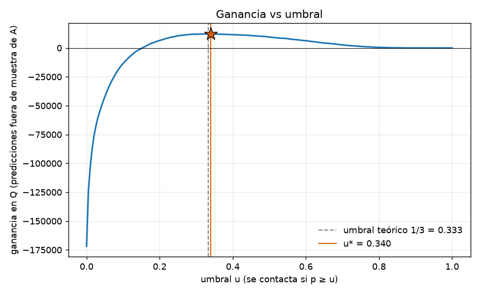

# Umbral de decisión por ganancia económica

Escenario: contactar cuesta Q5; si la persona iba a abandonar (y=1), la campaña la retiene con probabilidad 25% y retenerla vale Q60.

- Ganancia esperada por contactado: 0.25 × 60 × y − 5 = 15·y − 5.
- G(u) = Σ_{p ≥ u} (0.25·60·y − 5) = 15·TP − 5·(TP + FP).
- Umbral teórico: contactar si 15·p > 5, es decir p > 5 / (0.25·60) = **0.3333** (válido si p está calibrada).
- Umbral empírico u* = argmax G(u) sobre las predicciones fuera de muestra (OOF) de A del modelo `hgb`, malla de 201 umbrales en [0, 1] (empate: el mayor).

## Cuenta con u* = 0.340

- Contactados = 5102 de 51955 (TP = 2514, FP = 2588).
- G = 15·2514 − 5·(2514 + 2588) = 37710 − 25510 = **Q12200.00** (Q234.82 por cada 1 000 personas).
- Referencias: contactar a todos = Q-171740.00; no contactar a nadie = Q0.00.
- Precisión = 0.4927; recall = 0.4284.

Calibración: ver `calibracion.md` (Brier 0.0768; |u* − 1/3| = 0.007).
